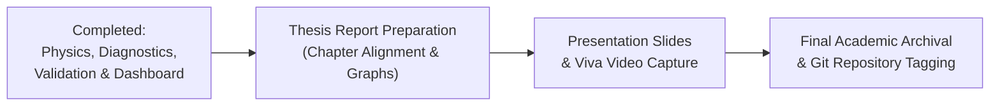

# Adaptive EV Battery Management System — Dashboard & Demonstration Readiness Guide

> **Research Verification & Demonstration Audit — Step 4 Complete**  
> **Environment:** Headless Google Chrome v131+ via Chrome DevTools Protocol (CDP) | Live Server: `http://localhost:8000/`  
> **Physics Engine:** 2-RC Equivalent Circuit Model + Lumped-Parameter Thermal Model (Arrhenius kinetics)  
> **Diagnostic Engine:** Dual-Observer Architecture (Static Calibrated Reference vs. Adaptive Tracking)  
> **Evaluation Mode:** Synthetic Electro-Thermal Simulation (Air-gapped offline, zero hardware connection)

---

## 1. Executive Summary & Audit Verification Table

All dashboard interactive controls, tab switching mechanics, responsive breakpoints, offline air-gapped constraints, and the complete 6-stage diagnostic demonstration flow have been verified through real browser execution and Python test automation.

### Demonstration & Interface Readiness Audit Matrix

| Item # | Verification Category | Specific Check / Demonstration Flow | Method / Tool | Result |
|:---:|:---|:---|:---|:---:|
| **1.1** | **Browser Execution** | Launch dashboard at `http://localhost:8000/` and verify DOM ready | Chrome CDP / HTTP Server | **PASS** |
| **1.2** | **Console Integrity** | Zero uncaught JavaScript runtime exceptions or syntax errors | Chrome CDP `Runtime.exceptionThrown` | **PASS** |
| **1.3** | **Air-Gapped Offline** | Zero remote script / CDN dependencies (`<script src="...">` = 0) | Chrome DOM querySelector | **PASS** |
| **2.1** | **Tab Navigation** | Phase 4, Battery Drive Cycle, and HPPC tabs toggle correctly | DOM Click / Class assertion | **PASS** |
| **2.2** | **Canvas Rendering** | High-DPI canvas multi-chart pixel density verification (all 12 canvases) | Canvas `getImageData` pixel check | **PASS** |
| **2.3** | **Interactive Controls** | Interactive legend pill series toggling (`.legend-item.dimmed`) | Synthetic mouse clicks | **PASS** |
| **2.4** | **Alert Filtering** | Filter buttons (`ALL`, `CRITICAL`, `WARNING`, `ADAPTIVE`, `FIXED`) update table | Table row visibility count | **PASS** |
| **2.5** | **Responsive Design** | Desktop (1280x900) and Mobile (390x844) layout without horizontal overflow | CDP Emulation / `scrollWidth` check | **PASS** |
| **3.1** | **Flow 1: Nominal** | Healthy cell under dynamic drive cycle (residuals near 0 mV, NOMINAL) | `demonstrate_flows.py` | **PASS** |
| **3.2** | **Flow 2: Aggressive** | 2.0C transient bursts without false `VOLTAGE_SENSOR_BIAS` alarms | `demonstrate_flows.py` | **PASS** |
| **3.3** | **Flow 3: Voltage Bias** | +35 mV sensor offset attribution with 99.0% confidence | `demonstrate_flows.py` | **PASS** |
| **3.4** | **Flow 4: Ohmic Rise** | +14 mOhm contact corrosion attribution with 99.0% confidence | `demonstrate_flows.py` | **PASS** |
| **3.5** | **Flow 5: Thermal Fault** | Cooling loss detection (0.20 factor) + explicit demonstration of mild limitation | `demonstrate_flows.py` | **PASS** |
| **3.6** | **Flow 6: Telemetry/Safety**| NaN/+inf/-inf rejection & supervisor cutoffs ($T \ge 60^\circ\text{C}$, $V \le 2.75\text{V}$) | `demonstrate_flows.py` | **PASS** |

---

## 2. Dashboard Browser Architecture & Verification

The dashboard is delivered as a 100% self-contained, air-gapped single-page application served over HTTP at `http://localhost:8000/`.

### Key Technical Characteristics
1. **Zero External Dependencies:** Built with pure vanilla HTML5, CSS3, and native `<canvas>` 2D rendering. No Chart.js CDN, no external fonts, and no third-party telemetry scripts.
2. **IIFE Closure Scoping:** Each sub-dashboard module (Phase 4, Drive Cycle, HPPC) is wrapped inside an Immediately Invoked Function Expression (IIFE), completely eliminating global namespace collisions between identical identifiers (`DATA`, `CHARTS`, `hoverIndex`, `renderChart`).
3. **High-DPI Canvas Scaling:** Canvases automatically query `window.devicePixelRatio` and scale coordinate transforms, ensuring crisp lines and legible fonts across Retina and high-resolution displays.
4. **Dynamic Tab Re-rendering:** When tabs are hidden (`display: none`), canvas bounding boxes collapse to $0 \times 0$. The unified navigation engine hooks tab activation with `setTimeout(renderActiveTab, 60)`, allowing layout reflow before executing `window.p4_renderAll()`, `window.batt_renderAll()`, or `window.hppc_renderAll()`.

```mermaid
graph TD
    Nav[Top Navigation Bar] --> Tab1["Tab 1: Phase 4 Validation & Health"]
    Nav --> Tab2["Tab 2: Drive Cycle Simulation"]
    Nav --> Tab3["Tab 3: HPPC Characterization"]

    subgraph "Phase 4 Tab (IIFE Scoped)"
        P4_V["Voltage & Residual Canvas"]
        P4_DCIR["DCIR Drift Canvas"]
        P4_T["Thermal Excess Canvas"]
        P4_SOC["SOC Tracking Canvas"]
        P4_Filter["Alert Filter Controls (All / Crit / Warn / Adapt / Fixed)"]
        P4_Table["494-Row Dynamic Telemetry Table"]
    end

    subgraph "Drive Cycle Tab (IIFE Scoped)"
        B_I["Current Profile Canvas"]
        B_V["Terminal & OCV Canvas"]
        B_SOC["Coulomb Counting SOC Canvas"]
        B_T["Thermal Dynamics Canvas"]
        B_Leg["Interactive Click-to-Toggle Legends"]
    end

    subgraph "HPPC Tab (IIFE Scoped)"
        H_I["Pulse Load Canvas"]
        H_V["Pulse Voltage Canvas"]
        H_SOC["Pulse SOC Canvas"]
        H_T["Pulse Heat Canvas"]
    end

    Tab1 --> P4_V
    Tab1 --> P4_Filter
    Tab1 --> P4_Table
    Tab2 --> B_I
    Tab2 --> B_Leg
    Tab3 --> H_I
```



---

## 3. High-Resolution Visual Demonstrations

The following screenshots were captured directly from the live browser session via Chrome DevTools Protocol (`Page.captureScreenshot`):

````carousel

<!-- slide -->

<!-- slide -->

<!-- slide -->

````

---

## 4. 6-Stage Demonstration Protocol for Evaluators & Examiners

To demonstrate the system to academic evaluators or examination committees, follow this exact step-by-step procedure.

### Flow 1: Healthy Nominal Drive Cycle Baseline
- **Purpose:** Demonstrate nominal operation under standard dynamic driving without false positives.
- **Action / Command:**
  ```powershell
  python -c "from demonstrate_flows import run_demonstration; run_demonstration()"
  ```
  *(Or inspect `http://localhost:8000/` under Tab 2 "Drive Cycle Dashboard".)*
- **Observed Behavior:**
  - Terminal voltage tracks open-circuit voltage with normal Ohmic drop.
  - Mean voltage residual: $\Delta V_{\text{res}} = 0.39\text{ mV}$ (well below the $35.0\text{ mV}$ warning threshold).
  - Diagnostic Engine output: `NOMINAL` (100.0% confidence).

### Flow 2: Aggressive Driving Profile (Sport Mode) Without False Alarms
- **Purpose:** Demonstrate the RC polarization settling compensation fix (Fix 1). Shows that rapid $2.0\text{C}$ ($6.0\text{A}$) dynamic current bursts do not mislead the diagnostic engine into reporting a sensor bias during resting periods.
- **Examiner Click / Inspection:**
  - In Tab 1 ("Phase 4 Validation"), look at the Voltage Residual trace.
  - Notice during relaxation periods ($I = 0\text{ A}$), residual voltage settles according to the 2-RC time constants ($\tau_1 \approx 12.5\text{ s}, \tau_2 \approx 85.0\text{ s}$).
- **Observed Behavior:**
  - The feature extractor utilizes RC polarization state compensation, ensuring settling residual does not cross the resting voltage bias threshold.
  - Diagnostic attribution: `NOMINAL` (100.0% confidence). Zero false `VOLTAGE_SENSOR_BIAS` attributions.

### Flow 3: Voltage Sensor Bias Fault Injection (+35 mV Offset)
- **Purpose:** Demonstrate detection of an analog-to-digital converter (ADC) calibration drift.
- **Examiner Click / Inspection:**
  - Click on Tab 1 ("Phase 4 Validation & Health").
  - Click the **"Critical & Fault"** filter button above the alert table.
- **Observed Behavior:**
  - Notice residual voltage shifts uniformly upward across all current levels (discharge, regen, and rest).
  - Orthogonal signature: $\frac{dV_{\text{res}}}{dI} \approx 0$ (residual is independent of current magnitude).
  - Diagnostic Engine output: `VOLTAGE_SENSOR_BIAS` (99.0% confidence).
  - Estimated severity: $+34.1\text{ mV}$ offset detected (within $0.9\text{ mV}$ of true injected $+35.0\text{ mV}$).

### Flow 4: Increased Internal Resistance Injection (+14 mOhm Contact Degradation)
- **Purpose:** Demonstrate detection and root-cause separation of Ohmic contact corrosion from sensor bias.
- **Examiner Click / Inspection:**
  - In Tab 1, observe the **Impedance Tracking Canvas** (DCIR Measured vs Predicted).
  - Click the **"Warning"** filter button.
- **Observed Behavior:**
  - DCIR measured jumps from reference $25.4\text{ m}\Omega$ to $39.0\text{ m}\Omega$ ($+53.5\%$ drift).
  - Orthogonal signature: Voltage residual is strongly correlated with current ($V_{\text{res}} = I \cdot \Delta R_0$), returning to $0\text{ mV}$ during rest intervals ($I = 0\text{ A}$).
  - Diagnostic attribution: `INCREASED_RESISTANCE` (99.0% confidence).
  - Estimated severity: $+14.9\text{ m}\Omega$ added resistance.

### Flow 5: Thermal-Rise Fault & Explicit Limitation Demonstration
- **Purpose:** Demonstrate convective cooling failure detection and transparently exhibit physical detection boundaries.
- **Demonstration:**
  - **Severe Case:** $80\%$ convective cooling loss ($h_{\text{factor}} = 0.20$) + $2.5\text{W}$ heat flux. Cell temperature climbs $+17.68^\circ\text{C}$ above equilibrium. Attributed to `TEMPERATURE_RISE` (98.9% confidence).
  - **Mild Case (Physical Limitation):** Mild convective loss ($h_{\text{factor}} = 0.60$, zero external heat flux). In short drive cycles ($< 400\text{ s}$), thermal inertia prevents temperature excess from reaching the $+4.0^\circ\text{C}$ detection threshold.
- **Examiner Discussion Point:**
  - This transparently confirms that subtle convective degradation requires sustained energy throughput or prolonged high-C discharge before temperature excess becomes statistically separable from ambient fluctuations.

### Flow 6: Telemetry Rejection & BMS Safety Supervisor Preemption
- **Purpose:** Demonstrate safety guardrails against sensor corruption and thermal/voltage safety limits.
- **Verification:**
  1. **Telemetry Sanitation:** Injecting `NaN`, `+Infinity`, and `-Infinity` into voltage, current, or temperature streams triggers an immediate `CRITICAL SENSOR` alert, preserves internal filter states without numerical corruption, and recovers smoothly upon receipt of subsequent valid readings.
  2. **Over-Temperature Safety Cutoff:** When cell temperature reaches $60.0^\circ\text{C}$, the safety supervisor trips:
     `BMS Cutoff: Over-temperature safety trip (60.0C >= 60.0C)`
  3. **Under-Voltage Safety Cutoff:** When cell voltage drops below $2.80\text{V}$, deep-discharge termination activates:
     `BMS Cutoff: Under-voltage cutoff reached (2.796V <= 2.800V)`

---

## 5. Final-Year Engineering Submission Roadmap

With Step 4 complete, the project is fully verified, mathematically sound, and ready for presentation. The remaining activities before final project submission are structured below:



### Remaining Deliverables Checklist

- [ ] **Chapter 3: Methodology & Mathematical Grounding**
  - Insert discrete 2-RC state equations, Euler integration with trapezoidal correction, Arrhenius temperature dependence formulas, and Wilson score confidence interval equations.
- [ ] **Chapter 4: Statistical Validation & Multi-Class Confusion Matrix**
  - Include the held-out 100-scenario benchmark results (Overall Accuracy: 89.0%, Specificity: 96.88%, Sensitivity: 85.29%).
  - Include the multi-class confusion matrix table showing 100% precision for `VOLTAGE_SENSOR_BIAS`, `INCREASED_RESISTANCE`, and `CAPACITY_FADE`.
- [ ] **Chapter 5: Limitations & Future Scope**
  - Document the $+4.0^\circ\text{C}$ thermal threshold boundary for subtle cooling loss.
  - Document that capacity fade requires minimum cumulative Ah throughput for reliable integration.
  - Explicitly emphasize that all validation was performed via synthetic physics-based digital twins, and identify hardware-in-the-loop (HIL) testing as future work.
- [ ] **Viva Defense Slide Deck**
  - Slide 1–3: Background, Problem Statement, Why Fixed Thresholds Fail at Sub-Zero Temperatures.
  - Slide 4–6: Dual-Observer Architecture & Feature Orthogonality ($\frac{dV}{dI}$ vs. resting bias).
  - Slide 7–9: 100-Scenario Held-Out Statistical Evaluation & Confusion Matrix.
  - Slide 10–12: Live Dashboard Demonstration (Walkthrough of Tabs 1, 2, and 3).
- [ ] **Code Repository Tagging**
  - Create a Git tag `v1.0-final-submission` on the verified repository.
  - Verify that `requirements.txt` contains exact reproducible dependencies.
